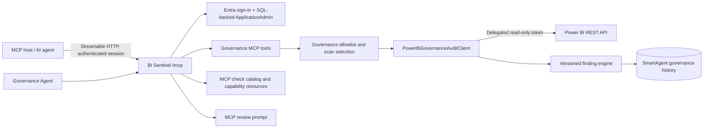
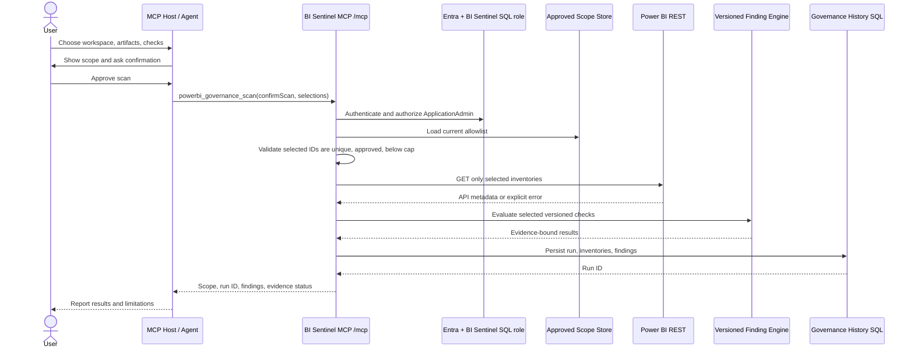
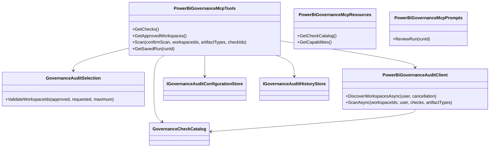
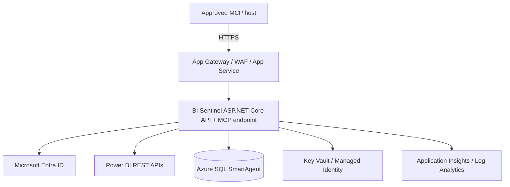

# BI Sentinel Power BI Governance Agent and MCP Architecture

**Status:** Implemented secure MCP foundation; enterprise target architecture and gaps are recorded below. This document does not imply that planned APIs, check families, or data stores are already deployed.

## Executive decision

Expose the existing BI Sentinel Governance Audit pipeline through the official .NET MCP SDK using Streamable HTTP at `/mcp`. MCP is an agent-facing contract, not a way to bypass BI Sentinel authorization or the saved workspace allowlist. The first release is read-only and supports the delegated-user REST API inventory for approved workspaces, Reports, Dashboards, Semantic Models, workspace users, and checks `GOV-001` through `GOV-008`.

The current deployment is **not yet the full tenant-wide GA-3 agent**. Tenant Admin/Scanner API access, dataflows and datamarts, refresh monitoring, Graph owner verification, configurable standards, exception approvals, discrepancy validation, complete structured API traceability, report generation, and standard OAuth authorization for external MCP clients are explicit follow-up gates. Do not mark those checks PASS or claim them as implemented.

## Existing implementation and explicit boundaries

| Capability | State | Boundary |
|---|---|---|
| Streamable HTTP MCP endpoint, tools, resources, prompt | Implemented at `/mcp` | Uses current Entra sign-in and BI Sentinel SQL-backed `ApplicationAdmin` role. |
| Approved workspace subset scanning | Implemented | Server reloads the administrator allowlist and rejects unknown, duplicate, empty, or over-limit workspace IDs. |
| Reports, Dashboards, and Semantic Models | Implemented | Uses delegated Power BI REST GET APIs. Approved workspaces are shown by API-returned names; reports and dashboards can be selected by name within those workspaces. |
| Installed Apps and Gateways | Implemented as optional account-level inventories | Apps are visible to the signed-in user and require `App.Read.All`; gateways are limited to those where the signed-in user is a gateway admin. They are explicitly selected and confirmed separately from workspace scope. |
| Workspace users and current eight checks | Implemented | `GOV-001`–`GOV-008` only; advisory, evidence-bound behavior. |
| Persisted findings/history | Implemented | Uses SQL migrations 007, 009, 010, 011, 013, 014, 015, and 016; apply them before deploying the current finding/artifact catalog. |
| MCP scan confirmation | Implemented as a required `confirmScan` tool input | MCP client/user must review and approve the scope before invoking the scan tool. MCP hosts should also display their normal tool-approval UX. |
| Tenant-wide Admin/Scanner API | Not implemented | Requires separate tenant settings, an approved service principal or tenant-admin delegated design, and isolated access review. |
| Dataflows and datamarts | Not implemented | These require broader API permissions/coverage; never present them as scan results or silently map them to another artifact kind. |
| Refresh history / consecutive failures / SLA | Not implemented | Current integration deliberately does not request dataset Write access. |
| Deleted/disabled owner validation through Graph | Not implemented | `configuredBy` is not proof of current identity status; Graph permissions and an identity resolver are required. |
| Workspace/report/dataset naming and governance metadata policies | Not implemented as configurable checks | The catalog contains only existing registered checks. |
| Exception registry / false-positive validation | Not implemented | No finding may be labeled `EXCEPTION_APPROVED` until a validated exception is persisted and audited. |
| External MCP OAuth 2.1 / Protected Resource Metadata | Not implemented | `/mcp` currently uses BI Sentinel's existing Entra web sign-in/session plus SQL application-admin roles. Do not expose it to third-party MCP clients until proper bearer-token/OAuth support is implemented and tested. |
| Durable MCP invocation audit | Partially implemented | Scan/tool/API calls log structured metadata via ASP.NET logging; configure protected production log export/retention. A dedicated immutable audit ledger is a production deployment gate. |

## 1. MCP server architecture



The MCP service is co-hosted with the authenticated ASP.NET Core API for this first implementation. It uses stateless Streamable HTTP to avoid in-memory protocol sessions and support App Service scale-out. It does not expose a tenant-wide connector or a new credential. A future separate MCP service may be introduced only after it has a documented OAuth resource-server design, tenant isolation, and shared authorization enforcement.

## 2. MCP tool definitions

Inputs below are JSON concepts; the .NET MCP SDK derives each implemented tool's JSON Schema from its typed method parameters. Outputs are JSON text results. Authentication and authorization run before tool handlers; invalid selections and unavailable services return MCP errors and are logged.

| Tool name | Input schema | Output | Error handling and audit |
|---|---|---|---|
| `powerbi_governance_get_checks` | `{}` | Versioned check catalog | Logs invocation; no Power BI call. |
| `powerbi_governance_get_approved_workspaces` | `{}` | Configuration version, approved workspace IDs, update time | SQL failure is an MCP tool error; no scope expansion. |
| `powerbi_governance_get_installed_apps` | `{}` | Installed app names and IDs visible to the signed-in user | Requires delegated `App.Read.All`; account-level scope is explicit. |
| `powerbi_governance_get_gateways` | `{}` | Gateway names and IDs where the signed-in user is an admin | Requires gateway-admin membership and Power BI `Dataset.Read.All`; permission denial is explicit. |
| `powerbi_governance_scan` | `{ "confirmScan": true, "workspaceIds"?: ["guid"], "artifactTypes"?: ["Reports","SemanticModels","Dashboards","Apps","Gateways"], "appIds"?: ["guid"], "gatewayIds"?: ["guid"], "checkIds"?: ["GOV-001"] }` | Saved run ID, selected scope, inventory, and traceable findings | Requires authenticated app admin; validates workspace IDs against current allowlist and server cap, and global artifact IDs against the signed-in user's Power BI response; logs request, selections, API calls, result counts, duration, and failure. |
| `powerbi_governance_get_saved_run` | `{ "runId": "guid" }` | Persisted run and findings | SQL failures and missing run produce explicit MCP errors and safe logs. |
| `powerbi_tenant_scanner` | Planned input: `{ "scanScope":"ALL_WORKSPACES" }` or an approved explicit scope | Planned: asynchronous scan/job summary | Not registered. Tenant scope must require a distinct privileged deployment and explicit authorization. |
| `powerbi_workspace_scanner` | Planned: `{ "scanScope":"SELECTED_WORKSPACES", "workspaceIds":[] }` or validated filters | Planned: workspace inventory with returned API fields | Not registered. Filters are not applied to inferred metadata. |
| `powerbi_report_scanner` | Planned: workspace IDs, report IDs, and supported report filters | Planned: returned report metadata and evidence | Not registered as a separate scanner. Reports are presently included in the generic scan. |
| `powerbi_semantic_model_scanner` | Planned: workspace IDs and semantic model IDs | Planned: returned semantic model metadata | Not registered separately. Models are presently included in the generic scan. |
| `powerbi_refresh_monitor` | Planned: dataset IDs, history window, failure/SLA policy IDs | Planned: refresh events and evidence | Not registered. The delegated app does not request dataset Write permission. |
| `powerbi_ownership_analyzer` | Planned: returned Power BI owner fields plus verified Graph identity identifiers | Planned: ownership status and evidence | Not registered. Missing or unverifiable owner must be `INSUFFICIENT_EVIDENCE`. |
| `powerbi_governance_metadata_reader` | Planned: workspace/artifact IDs and allowed metadata fields | Planned: API-returned governance metadata | Not registered. Never synthesize missing attributes. |
| `powerbi_exception_registry` | Planned: validated exception read/create/revoke request and approval reference | Planned: exception record and validation decision | Not registered. Any write requires an approver policy, immutable audit event, expiration, and optimistic concurrency. |
| `powerbi_findings_repository` | Planned: run/check/artifact filters and a controlled feedback/validation operation | Planned: findings and validation state | Partly covered by `get_saved_run`; no validation labels or write operations currently exist. |
| `powerbi_governance_report_generator` | Planned: run ID, output format, approved report sections | Planned: versioned report document | Not registered; must generate from persisted evidence, not LLM-created facts. |

**Shared tool error contract:** authentication/authorization denial; invalid schema/selection; unsupported capability; Power BI consent/permission/throttle/unavailable; SQL persistence/read failure; cancellation. Never return access tokens, raw authorization headers, secrets, or success-shaped fallback data.

## 3. MCP resources

Implemented read-only resources:

| URI | MIME type | Content |
|---|---|---|
| `bi-sentinel://governance/check-catalog` | `application/json` | Current versioned GovernanceCheckCatalog. |
| `bi-sentinel://governance/capabilities` | `application/json` | Supported and unsupported features plus evidence safety statement. |

Planned resources include `bi-sentinel://governance/runs/{runId}`, `bi-sentinel://governance/exceptions/{exceptionId}`, and `bi-sentinel://governance/schemas/finding`. Persisted run retrieval is presently a tool because the existing history store API is run-ID based.

## 4. Prompt templates and agent instructions

Implemented MCP prompt `review_powerbi_governance_run(runId)` instructs the agent to load a saved run, cite returned evidence only, distinguish statuses, summarize by severity/check, and clearly state scope and evidence gaps.

The workspace agent definition is in [powerbi-governance.agent.md](../.github/agents/powerbi-governance.agent.md). It is designed to call the MCP tools only after displaying the scan scope and requesting user confirmation. It is not a substitute for service authorization, API consent, or MCP host-level tool approval.

## 5. Power BI API integration layer

### Implemented delegated endpoints

| Data | Current endpoint | Permission / behavior |
|---|---|---|
| Accessible workspaces | `GET /groups?$top=...&$skip=...` | Delegated signed-in user visibility; discovery is admin-only and does not change the stored allowlist. |
| Workspace metadata | `GET /groups/{workspaceId}` | Reads only selected allowlisted IDs. |
| Reports | `GET /groups/{workspaceId}/reports` | Requested only when Reports is selected. |
| Dashboards | `GET /groups/{workspaceId}/dashboards` | Requested only when Dashboards is selected; requires delegated `Dashboard.Read.All`. |
| Semantic models | `GET /groups/{workspaceId}/datasets` | Requested only when Semantic Models is selected. |
| Workspace access | `GET /groups/{workspaceId}/users` | Used for current admin/guest/role checks. |
| Installed Apps | `GET /apps` | Optional account-level inventory; requires delegated `App.Read.All`; returns apps installed for the signed-in user, not workspace ownership. |
| Gateways | `GET /gateways` | Optional account-level inventory; requires the signed-in user to be a gateway administrator. Power BI documents `Dataset.Read.All` as a supported scope. |

Calls are GET-only, use bearer tokens from Microsoft.Identity.Web token acquisition, avoid logging token data, and log endpoint/status/duration. The current scope and artifact guards are server-side.

### Required admin/API expansion

Do not treat the current delegated workspace-list API as a tenant scanner. An Admin/Scanner API workstream must validate tenant settings, service principal profile or admin delegated flow, tenant-wide API constraints, rate limits, continuation tokens, sensitivity data minimization, retry/backoff, and workspace/artifact caps. Scanner API supports metadata extraction at scale but does not replace endpoints required for refresh/ownership evidence. A selected report filter must resolve IDs from API results and not use display name as identity.

### GA-3 checks

Only checks approved in the versioned catalog execute. Current catalog checks are `GOV-001` through `GOV-008`. The GA-3 categories are planned as separate check packages:

- Standards violations: naming and required metadata once standards are administrator-configured and versioned.
- Orphan candidates: owner or dependency candidates with explicit false-positive guidance; verified missing/deleted/disabled owner requires Graph and fresh evidence.
- Failed refreshes: last failure, consecutive failure count, and SLA only after the required refresh source, permission, time zone, retention, and schedule rules are configured.
- Ownership/governance gaps: a missing attribute is evaluable only when an API source returns the relevant metadata field or a metadata contract defines that it is absent.

Each check has stable ID, semantic version, name, severity, owner, definition, deterministic evaluation logic, evidence source, and exception policy. A change to rule logic increments its version and preserves prior finding snapshots.

## 6. Authentication design

### Current implementation

- Entra OIDC authorization-code flow with PKCE authenticates app users.
- `PowerBiDelegatedAccessTokenProvider` requests existing delegated Power BI read scopes for the signed-in user.
- MCP endpoint uses the same Entra web session and app identity middleware as Governance REST routes.
- Power BI consent is separate from BI Sentinel sign-in.
- Tokens are acquired server-side and never returned to MCP clients or logged.

### Production external MCP gate

Before connecting remote MCP hosts, implement and validate an OAuth 2.1 resource-server flow for `/mcp` (Entra access-token audience/issuer validation, scopes/roles, protected resource metadata/discovery, tenant binding, token expiry, 401 challenge behavior, and SQL-backed application authorization). Do not ask users to copy browser cookies into clients. Confirm the MCP SDK's authorization behavior and host interoperability in integration tests. Internal browser-hosted use is restricted to app-admin role until then.

## 7. Authorization design

1. Entra validates tenant and identity.
2. `ApplicationUserAccessMiddleware` provisions/loads the user from SQL and checks enabled/admin state.
3. `/mcp` and Governance readers require the SQL-backed `ApplicationAdmin` role.
4. The workspace scan selection must be a non-empty unique subset of the latest approved workspace IDs and must remain below `GovernanceAudit:MaximumWorkspacesPerScan`.
5. Administration controls allowlist management; scan callers cannot write it.
6. Every MCP scan is read-only against Power BI. Exception creation, configuration writes, workspace mutation, and refresh mutation are not tools.
7. Any future service-principal scanner gets its own authorization policy, secret/certificate lifecycle, and separate approved scope; it must not inherit the delegated-user scope silently.

## 8. Findings data model

### Current persisted shape

Migrations 007 and 009 store scan run, scanned workspaces, users, normalized Reports/Semantic Models, and findings; migration 010 extends persisted workspace artifact types to Dashboards, while migration 011 stores account-level Apps and Gateways separately from workspace-linked artifacts. Existing `GovernanceFinding` records include check version/owner/severity, workspace/artifact identity, status, expected/actual value, evidence JSON, evidence source string, and capture timestamp.

### Target JSON contract

```json
{
  "findingId": "guid",
  "runId": "guid",
  "checkId": "GOV-001",
  "checkVersion": "1.0.0",
  "severity": "Warning",
  "artifactType": "Workspace",
  "artifactId": "guid",
  "artifactName": "Finance",
  "workspaceId": "guid",
  "workspaceName": "Finance",
  "status": "INSUFFICIENT_EVIDENCE",
  "summary": "Visible administrator status could not be established",
  "explanation": "The caller returned no visible admin entry; this is not proof no tenant admin exists.",
  "evidenceSource": "Power BI REST API",
  "evidenceEndpoint": "GET /groups/{workspaceId}/users",
  "evidenceTimestamp": "2026-10-29T10:00:00Z",
  "metadataEvaluated": {
    "returnedPrincipalCount": 0,
    "selectedWorkspaceId": "guid"
  }
}
```

Current enum values are `PASS`, `FAIL`, and `INSUFFICIENT_EVIDENCE`. Add `EXCEPTION_APPROVED` only with the exception registry and immutable approval audit flow. Findings must not be emitted when neither a source response nor an explicit source-unavailability record exists. Current evidence source definitions identify route families; the target adds a structured endpoint and per-call correlation ID to each finding.

## 9. Exception data model and validation

No exception store exists yet. Target exception fields:

```json
{
  "exceptionId": "guid",
  "checkId": "GOV-004",
  "artifactType": "SemanticModel",
  "artifactId": "guid",
  "workspaceId": "guid",
  "owner": "Entra object ID",
  "approvalDate": "2026-10-29T10:00:00Z",
  "expirationDate": "2027-01-29T10:00:00Z",
  "approvedBy": "Entra object ID",
  "reason": "Approved cross-workspace consumption",
  "auditReference": "change-ticket",
  "status": "ACTIVE"
}
```

Only active, unexpired, scope-matching records with non-empty owner, approver, approval date, expiration, and audit reference can suppress a finding. The actor cannot approve their own exception unless policy explicitly authorizes it. Expired/revoked/invalid exceptions are retained in audit history, not deleted. Exception use records exception ID, check/finding ID, evaluator version, time, and actor.

## 10. Governance report schema

Planned report output is versioned JSON plus optional CSV/PDF rendering from persisted run data:

```json
{
  "reportVersion": "1.0.0",
  "runId": "guid",
  "scanSummary": {},
  "scopeExecuted": {},
  "workspacesScanned": 0,
  "reportsScanned": 0,
  "datasetsScanned": 0,
  "findingsBySeverity": {},
  "findingsByCheck": {},
  "passedChecks": 0,
  "failedChecks": 0,
  "exceptionsApplied": 0,
  "insufficientEvidenceCases": 0,
  "falsePositiveAnalysis": null,
  "apiSourcesUsed": [],
  "evidenceCollectionTimes": [],
  "traceabilityMatrix": []
}
```

`falsePositiveAnalysis` remains null until governance-owner validation data exists. The report generator must not imply validation accuracy when no labeled comparison dataset is configured.

## 11. Traceability matrix

Each row must bind `findingId → checkId + version → API source + endpoint + call correlation ID → evidence timestamp → evaluated metadata → determination/status`. Store the immutable check definition snapshot and metadata JSON alongside the finding. Current history has finding evidence and source/timestamp; structured endpoint/correlation linkage is a schema enhancement still required for the full target.

## 12. Sequence diagram



## 13. Class diagram



Target extension points are `IGovernanceCheck`, `IGovernanceEvidenceProvider`, `IExceptionRegistry`, `IGovernanceReportGenerator`, and `IGovernanceAuditEventStore`. Introduce them only when their backing implementations exist; avoid registering no-op providers.

## 14. Database schema

### Existing

- `BiAgentGovernanceAuditConfiguration` and `BiAgentGovernanceAuditWorkspaces`: current approved scope and configuration audit snapshot.
- `BiAgentGovernanceAuditRuns`: run identity and scan attribution.
- `BiAgentGovernanceAuditRunWorkspaces`, `...RunUsers`, `...RunArtifacts`, `...RunFindings`: persisted scan inventory and findings.
- Migration 009 enriches findings with version, owner, result status, evidence, and expected/actual values; migration 010 allows Dashboard inventory persistence.

### Target additive schema

- `BiAgentGovernanceExceptions`: exception identity, check/artifact scope, owner/approver, reason, dates, audit reference, state, concurrency token.
- `BiAgentGovernanceExceptionAudit`: append-only created/approved/rejected/revoked/expired/applied events with actor, timestamp, and before/after hashes.
- `BiAgentGovernanceAuditEvents`: MCP/API request ID, actor ID, tool/API name, scope hash or IDs (policy-controlled), check IDs, duration, counts, outcome, error class; never store tokens or raw request bodies.
- `BiAgentGovernanceValidationLabels`: expected outcome, annotator, evidence reference, label version and timestamp.
- `BiAgentGovernanceReports`: report version, run ID, generated time, schema version, and content hash; large report bodies may be stored in approved private Blob Storage.
- `BiAgentGovernanceRunScope`: exact workspace/artifact/check selection snapshot, API policy versions, and collection configuration for reproducibility.

Use additive SQL migrations only; deploy schema before app code. App identity gets least-privilege stored-procedure/table permissions. Apply migrations 001–009 as documented before current Governance usage; any future target tables need later migrations and an explicit deployment runbook. Do not assume a migration ran merely because a script exists.

## 15. Deployment and Azure hosting architecture



Current app deployment may host MCP alongside API on Windows App Service. Require TLS, private/approved ingress where possible, managed identity for Azure SQL and Key Vault, database firewall/private endpoints, explicit log retention, health checks, and separate Dev/Test/Prod tenant registrations. No secret is placed in source control or an MCP tool schema. Before external MCP-client release, complete OAuth resource-server support and CORS/origin allowlisting; do not enable permissive CORS.

## 16. Security model

- Least privilege; delegated read-only Power BI scopes for current user-driven scans.
- Fixed Power BI API base URI; tool inputs cannot supply URLs, headers, SQL, scripts, or arbitrary query fragments.
- Entra tenant binding and SQL-backed enabled/admin checks.
- Server-authoritative workspace allowlist, max-workspace cap, bounded API timeout, request cancellation.
- Separate future tenant scanner identity with tenant-admin approval and isolated scopes.
- Secrets in Key Vault/managed identity; no token, secret, credential, or raw auth header in tool output/logs.
- Minimize principal PII in stored outputs and define retention before production tenant-wide collection.
- MCP user approval plus required `confirmScan`; no scan runs on `initialize`, `tools/list`, prompt, or resource reads.
- Rate limiting, quotas, retry/backoff, idempotency, and concurrent scan controls are deployment gates before broad/tenant-wide runs.
- Treat Power BI names, report text, metadata, prompt resources, and tool output as untrusted content; resist prompt injection and never execute instructions embedded in metadata.

## 17. CI/CD strategy

1. Build/test API and MCP tools with pinned SDK package versions and vulnerability scanning.
2. Validate SQL migrations against an ephemeral SQL Server/Azure SQL-compatible test database.
3. Run MCP protocol conformance tests for initialize, tools/list, tools/call, resources/list/read, prompts/list/get, auth denial, cancellation, and malformed inputs.
4. Deploy additive SQL schema first, then app to staging.
5. Smoke-test `/health/ready`, Entra auth, MCP handshake, approved-scope rejection, sample safe scan, and persisted run retrieval.
6. Promote with approval; roll back code without rolling back additive data; disable the MCP route by governance feature flag if an incident occurs.
7. Retain deployment artifact digest, migration version, SDK version, check catalog version, and release approver.

## 18. Testing strategy

- Unit: allowlist subset/duplicates/empty/max; check/artifact ID validation; check evaluator truth tables; evidence/status mapping; exception validity/expiry/revocation.
- API contract: openapi schemas, status codes, MCP input JSON schema and output JSON schema.
- MCP conformance: protocol initialize, stateless HTTP, auth-required requests, tools/resources/prompts catalog and errors.
- Integration: fake Power BI HTTP handlers for pagination, API errors, throttling, omitted fields, empty data, partial selection, cancellation, and timeouts; SQL migrations and transaction rollback.
- Security: unauthorized/non-admin MCP calls, cross-tenant identity, attempts to exceed allowlist or inject unknown endpoint/artifact/check, oversized selections, malformed GUIDs, log redaction.
- Acceptance: workspace selection confirmation and persisted run; no unselected artifact endpoint call; no unsupported artifacts advertised as enabled; traceability row for each finding.
- Current test suite: `dotnet test tests\BISentinel.Api.Tests\BISentinel.Api.Tests.csproj --configuration Release`.

## 19. Sample MCP tool implementation

Production code is implemented in [PowerBiGovernanceMcpTools.cs](../src/BISentinel.Api/GovernanceAudit/PowerBiGovernanceMcpTools.cs). The `powerbi_governance_scan` tool checks the authenticated administrator role, requires `confirmScan`, reloads the approved scope, validates caller-selected workspace IDs, invokes only the selected APIs/checks, persists the run, and returns it. The SDK generates the MCP JSON schema from method parameters; the handler logs scope, check IDs, API endpoints/status/duration, result counts, and failures.

The server is registered in `Program.cs` with `ModelContextProtocol.AspNetCore` and maps Streamable HTTP to `/mcp`. The MCP server is disabled when Governance Audit is disabled. Local operation and external OAuth limitations are listed above; do not connect a public host until that gate is complete.

## 20. Production readiness checklist

- [x] Official MCP C# SDK Streamable HTTP endpoint, tools, resources, and prompt.
- [x] Entra sign-in and SQL app-admin authorization on the current deployment path.
- [x] Existing read-only API scanner reused; server-side approved scope enforced.
- [x] Supported artifact/check selection and audit/history persistence.
- [x] Explicit capability resource and documented non-implemented items.
- [ ] OAuth 2.1 bearer/resource-server auth for external MCP clients.
- [ ] Tenant Admin API / Scanner API approval, registration, and bounded asynchronous scan jobs.
- [x] Dashboard inventory, scoped name selection, and persisted artifact schema.
- [x] Installed-app inventory and gateway-admin inventory, explicitly separated from workspace scope.
- [ ] Dataflow/datamart connectors and permissions review.
- [ ] Refresh monitor design/permission approval and evidence tests.
- [ ] Graph identity verification and ownership policies.
- [ ] Configurable independent check packages and approved standards.
- [ ] Exception registry, dual-control approval, revocation, and immutable audit.
- [ ] False-positive validation data, precision/recall and discrepancy reports.
- [ ] Structured API endpoint/correlation ID on every persisted evidence item.
- [ ] Durable MCP API/tool audit ledger, retention and alerting.
- [ ] Versioned governance report generator.
- [ ] MCP conformance, OAuth security, scale and tenant-load integration tests.

## References

- [Model Context Protocol specification](https://modelcontextprotocol.io/specification/2025-11-25)
- [Official MCP C# SDK](https://github.com/modelcontextprotocol/csharp-sdk)
- [Microsoft .NET MCP server quickstart](https://learn.microsoft.com/en-us/dotnet/ai/quickstarts/build-mcp-server)
- [BI Sentinel Governance Audit implementation notes](../README.md#governance-audit-read-only-pilot)
- [Power BI Scanner API](https://learn.microsoft.com/en-us/rest/api/power-bi/admin/workspace-info-post-workspace-info)
- [Power BI refresh history API](https://learn.microsoft.com/en-us/rest/api/power-bi/datasets/get-refresh-history-in-group)
